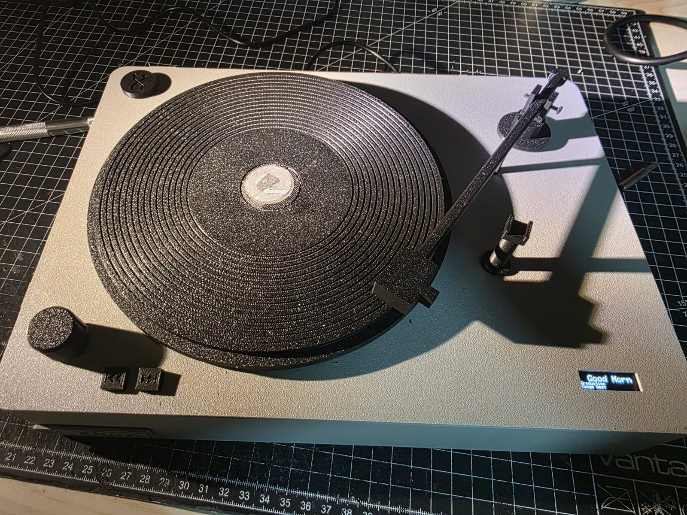
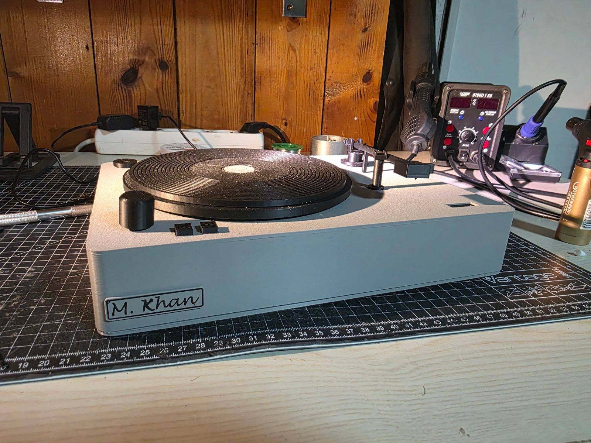
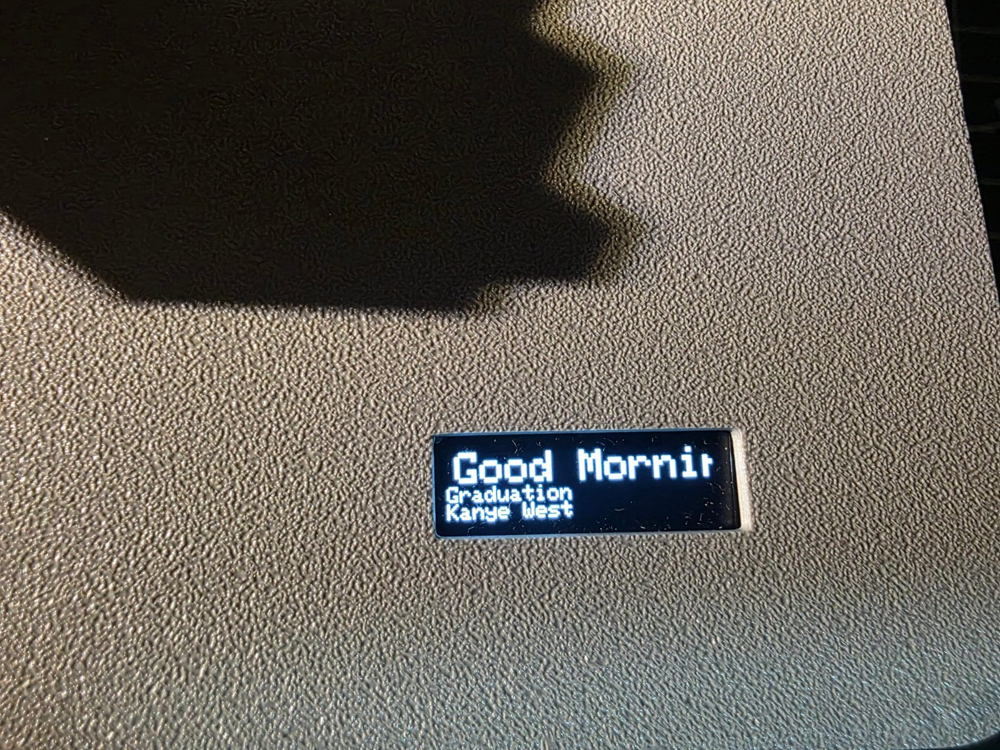

# RFID Turntable

A small fake record player with 3D printed records. Each record has an NFC tag with a Spotify link inside. Put a record on, lower the tonearm, and an ESP32 starts that album or playlist on an Amazon Echo while the platter turns.

The Spotify link is stored on the record, not in the device. So any record works on any of these players, a record I make also plays at a friend's place.

<p>
  
  
</p>

## Demo

<!-- VIDEO: drag turntable_demo.mp4 into this spot in the GitHub web editor -->

Record on, tonearm down, music starts on the Echo. Then volume, skipping and shuffle. The phone microphone makes the stepper sound much louder than it is in the room, with music playing you do not hear it. The video still shows the German display texts of an earlier build.



## Features

* Record on + tonearm down starts the album at track 1, like a real record
* Tonearm up pauses, down again continues, taking the record off resets it
* Knob for volume (press to mute), buttons for next / previous track and shuffle
* 128x32 OLED shows the current track, album and artist, long titles scroll
* Wakes the Echo up if Spotify accepts the command but nothing plays, and finds it again if its device ID changes
* Recovers by itself from lost connections (reconnects WiFi, restarts as a last resort, watchdog on the Spotify task)

## Hardware

| Part | Use |
| --- | --- |
| ESP32 DevKit | controller, WiFi |
| RC522 (13.56 MHz) | reads the NFC tag through the platter |
| NTAG213 stickers | one per record, NDEF URI record with the Spotify link |
| 28BYJ-48 + ULN2003 | turns the platter via a rubber belt |
| KY-040 rotary encoder | volume / mute |
| 3x 12x12 push buttons | next, previous, shuffle |
| Micro switch | detects the tonearm |
| SSD1306 OLED 128x32 | track info |
| USB 5 V / 2 A supply | power |

Wiring and schematic: [docs/wiring.md](docs/wiring.md)

## How it works

**Reading the record.** The RC522 is fixed under the centre of the platter, the tag sits in the centre of the record, so it stays above the reader while turning. The firmware reads the NTAG213 user memory (pages 4 to 39), parses the NDEF TLV and record headers itself, finds the URI record and turns `https://open.spotify.com/album/ID` into `spotify:album:ID`. The MFRC522 library only gives raw pages, so the NDEF part is my own code. Holding a record to a phone opens the link in Spotify as well.

**Talking to Spotify.** The ESP32 uses the Spotify Web API directly. Login is OAuth Authorization Code with PKCE, so no client secret is stored on the device. The refresh token is kept in flash because Spotify can replace it. Requests go over one kept-alive HTTPS connection with a small hand written HTTP/1.1 client (content length and chunked bodies), which saves about a second per command compared to opening a new connection every time.

**Tasks.** `loop()` only reads inputs and never waits for the network, so the buttons and the knob always react immediately. It puts jobs into a small shared job list. `spotifyTask` on core 0 works through them and merges what comes in faster than Spotify answers, e.g. five detents on the knob become one "+25 %" request. The stepper and the display run in their own tasks on core 1.

## Repository layout

```
firmware/turntable/   main firmware
firmware/rfid_test/   first test sketch, dumps the tag memory
tools/                Python tool for the Spotify login and playback tests
cad/print/            print files and assembly guide
cad/fit_tests/        small test prints used to check fits before the full print
docs/                 wiring and schematic
```

## Setup

1. Create an app on developer.spotify.com and add `http://127.0.0.1:8888/callback` as redirect URI.
2. `python tools/spotify_test.py login` logs you in once and saves the refresh token in `tools/token.json`.
3. `python tools/spotify_test.py devices` lists your devices, copy the ID of the Echo. It sometimes only shows up after it played Spotify shortly before.
4. Copy `firmware/turntable/secrets.example.h` to `secrets.h` and fill in WiFi, client ID, refresh token and device ID. `secrets.h` is in `.gitignore`.
5. Arduino IDE, board "ESP32 Dev Module", libraries MFRC522, Adafruit SSD1306, Adafruit GFX and ArduinoJson 7. Flash `firmware/turntable`.
6. Write a Spotify album or playlist link to an NTAG213 sticker with a phone app such as NFC Tools.

Playlists have to be public or shared, otherwise another account cannot play them. Albums always work. Spotify Premium is required for playback control.

## Status

Firmware 2.2 has all the features above. The case is printed and being assembled.

Open:

- [ ] drill the shuffle hole with the template and fit holder and puck
- [ ] check after assembly whether `TONEARM_PRESSED_MEANS_DOWN` has to be `true`
- [ ] setup without editing code: the ESP32 opens its own WiFi with a web page to choose the home network and log in to Spotify (captive portal)
- [ ] optional 18650 cell as a buffer, so it runs for a while without a cable

Lesson for a next version: mount all brackets and mechanics on the base and only put the lid over it, so everything can be tested open.

## License

MIT
