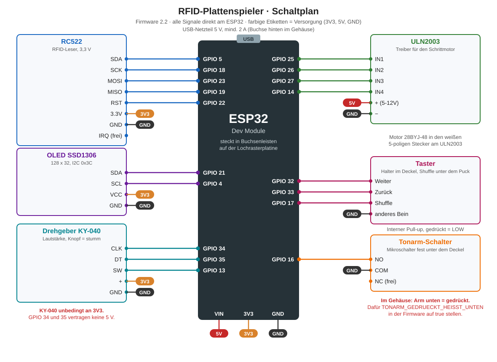

# Verkabelung

Stand Firmware 2.2. Wenn sich ein Pin ändert, wird diese Datei zusammen mit der Firmware angepasst. Maßgeblich sind die Konstanten oben in `firmware/plattenspieler/plattenspieler.ino`.

## Grundidee

Der ESP32 steckt in zwei Buchsenleisten auf einer Lochrasterplatine 5 x 7 cm. Auf dieselbe Platine kommen Stiftleisten für jedes Modul, dazu je eine Sammelschiene für 3V3, 5V und GND. Die Module hängen mit Jumper-Kabeln (Buchse auf Buchse) an diesen Stiftleisten. Fällt ein Teil aus, wird es einfach abgesteckt.

Strom kommt nur über die USB-Buchse des ESP32. Ein eigener Spannungsregler ist nicht nötig. Das Netzteil sollte 5 V und mindestens 2 A liefern, weil Motor und WLAN zusammen etwa 0,6 bis 0,7 A ziehen.

## Pinbelegung am ESP32

| GPIO | Geht an | Funktion | Bemerkung |
| --- | --- | --- | --- |
| 5 | RC522 SDA | SPI Chip Select | |
| 18 | RC522 SCK | SPI Takt | |
| 23 | RC522 MOSI | SPI Daten zum Leser | |
| 19 | RC522 MISO | SPI Daten vom Leser | |
| 22 | RC522 RST | Reset | |
| 21 | OLED SDA | I2C Daten | |
| 4 | OLED SCL | I2C Takt | |
| 34 | KY-040 CLK | Drehgeber A | nur Eingang, Pull-up sitzt auf dem KY-040 |
| 35 | KY-040 DT | Drehgeber B | nur Eingang, Pull-up sitzt auf dem KY-040 |
| 15 | KY-040 SW | Knopf (stumm) | interner Pull-up, vorher 13 |
| 25 | ULN2003 IN1 | Motor Spule A | |
| 26 | ULN2003 IN2 | Motor Spule B | |
| 27 | ULN2003 IN3 | Motor Spule C | |
| 14 | ULN2003 IN4 | Motor Spule D | zuckt beim Einschalten kurz, harmlos |
| 33 | Taster Weiter | nächster Titel | interner Pull-up, gedrückt = LOW |
| 32 | Taster Zurück | vorheriger Titel | interner Pull-up, gedrückt = LOW |
| 17 | Taster Shuffle | Zufall an und aus | interner Pull-up, gedrückt = LOW |
| 16 | Tonarm-Schalter NO | Tonarm unten/oben | interner Pull-up |

## Versorgung

| Schiene | Kommt von | Geht an |
| --- | --- | --- |
| 5V | ESP32 Pin VIN (USB-Spannung) | ULN2003 + |
| 3V3 | ESP32 Pin 3V3 | RC522 3.3V, OLED VCC, KY-040 + |
| GND | ESP32 GND | alle Module, alle drei Taster, Tonarm-Schalter COM |

Wichtig. Der KY-040 muss an 3V3 hängen. GPIO 34 und 35 vertragen keine 5 V. Der RC522 läuft ebenfalls nur mit 3,3 V. Auf die 5V-Schiene kommt ausschließlich der ULN2003.

## Stecker auf der Lochrasterplatine

Die Reihenfolge der Stiftleisten entspricht der Reihenfolge am jeweiligen Modul. So laufen die Jumper-Kabel gerade und ohne Überkreuzen.

| Stecker | Polig | Reihenfolge | Modul |
| --- | --- | --- | --- |
| J1 | 8 | SDA (5), SCK (18), MOSI (23), MISO (19), IRQ (frei), GND, RST (22), 3V3 | RC522 |
| J2 | 4 | GND, VCC (3V3), SCL (4), SDA (21) | OLED |
| J3 | 5 | CLK (34), DT (35), SW (15), + (3V3), GND | KY-040 |
| J4 | 4 | IN1 (25), IN2 (26), IN3 (27), IN4 (14) | ULN2003 Eingänge |
| J5 | 2 | + (5V), − (GND) | ULN2003 Versorgung |
| J6 | 3 | Weiter (33), Zurück (32), GND | Taster-Platine im Deckel |
| J7 | 2 | NO (16), COM (GND) | Tonarm-Schalter |
| J8 | 2 | Shuffle (17), GND | Shuffle-Taster unter dem Puck |

Vor dem Einstecken die Beschriftung am eigenen Modul prüfen. Gerade beim OLED gibt es Varianten mit VCC und GND vertauscht.

## Taster im Deckel

Weiter und Zurück liegen im gedruckten Bedienhalter (`cad/druck/07_Bedienhalter_Taster_Encoder_grau`), der von unten an die zwei Dome neben den Tastenlöchern geschraubt wird. Die Beinchen schauen unten aus dem Halter raus, dort werden die Kabel direkt angelötet. Je ein Bein beider Taster wird verbunden und geht als gemeinsames GND an J6, das jeweils andere Bein einzeln an Weiter und Zurück. Bei den 4-beinigen 12 x 12 Tastern sind je zwei Beine intern verbunden. Diagonal gegenüberliegende Beine verwenden, dann stimmt es sicher.

Der Shuffle-Taster sitzt in einem eigenen kleinen Halter unter dem Puck hinten links. Ein Bein an GPIO 17, das diagonal gegenüberliegende an GND (J8).

## Tonarm-Schalter

COM an GND, NO an GPIO 16, NC bleibt frei. Der Schalter sitzt fest unter dem Deckel neben der Tonarmsäule. Im Gehäuse drückt der Schaltklotz am Arm durch das Loch im Deckel auf den Schalter, wenn der Arm auf der Platte liegt. Auf dem Steckbrett war es andersherum, deshalb steht in der Firmware im Moment `TONARM_GEDRUECKT_HEISST_UNTEN = false`. Nach dem Einbau prüfen. Wenn die Anzeige Pause zeigt, obwohl der Arm auf der Platte liegt, die Konstante auf `true` stellen.

## Motor

Der 28BYJ-48 steckt mit seinem weißen 5-poligen Stecker direkt im ULN2003. Die LEDs auf dem ULN2003 zeigen, welche Spule gerade bestromt wird. Leuchten sie im Stand dauerhaft, schaltet die Firmware die Spulen nicht ab.

## Checkliste vor dem ersten Einschalten im Gehäuse

1. Mit dem Multimeter prüfen, dass 3V3, 5V und GND nicht miteinander kurzgeschlossen sind.
2. KY-040 und RC522 hängen an 3V3, nicht an 5V.
3. Nur der ULN2003 hängt an 5V.
4. Erst ohne Module einschalten, Spannung an den Schienen messen, dann Module einstecken.
5. Im Seriellen Monitor muss `RC522 erkannt` erscheinen und das Display den Startbildschirm zeigen.
