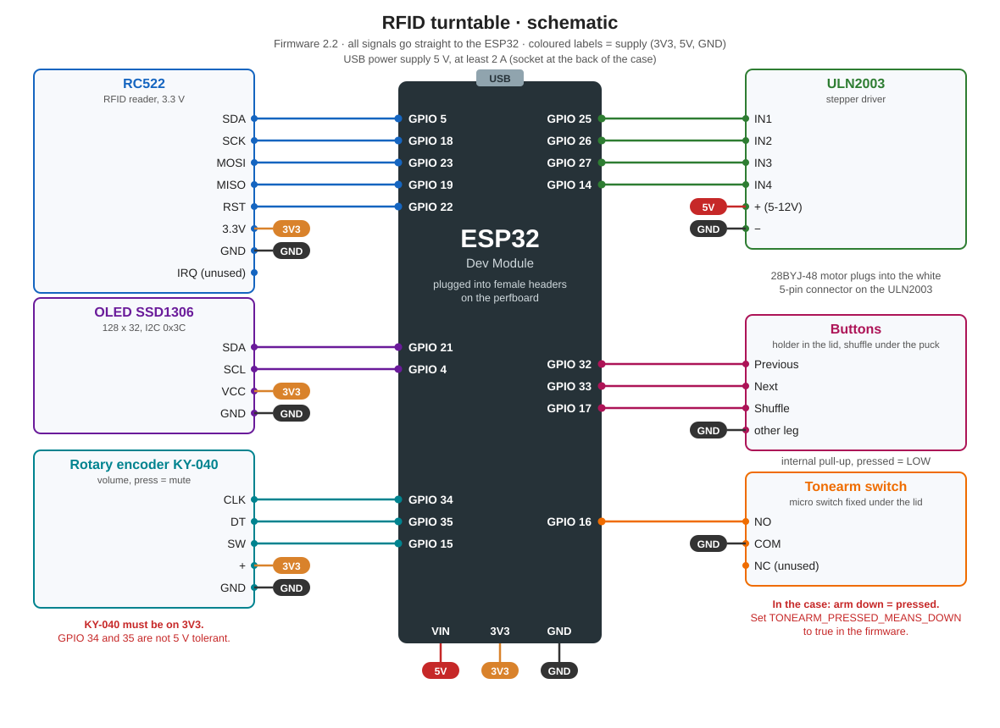

# Wiring

State of firmware 2.2. The pin constants at the top of `firmware/turntable/turntable.ino` are the reference, this file is updated together with them.

## Idea

The ESP32 sits in two female headers on a 5 x 7 cm perfboard. The same board has a pin header for every module plus one rail each for 3V3, 5V and GND. The modules connect with female to female jumper wires, so a broken part can simply be unplugged.

Power comes only through the ESP32's USB socket, no extra regulator. The power supply should deliver 5 V and at least 2 A, motor and WiFi together draw about 0.6 to 0.7 A.

## ESP32 pins

| GPIO | Goes to | Function | Note |
| --- | --- | --- | --- |
| 5 | RC522 SDA | SPI chip select | |
| 18 | RC522 SCK | SPI clock | |
| 23 | RC522 MOSI | SPI data to reader | |
| 19 | RC522 MISO | SPI data from reader | |
| 22 | RC522 RST | reset | |
| 21 | OLED SDA | I2C data | |
| 4 | OLED SCL | I2C clock | GPIO 22 is taken by the RC522 |
| 34 | KY-040 CLK | encoder A | input only, pull-up is on the KY-040 |
| 35 | KY-040 DT | encoder B | input only, pull-up is on the KY-040 |
| 15 | KY-040 SW | knob button (mute) | internal pull-up |
| 25 | ULN2003 IN1 | motor coil A | |
| 26 | ULN2003 IN2 | motor coil B | |
| 27 | ULN2003 IN3 | motor coil C | |
| 14 | ULN2003 IN4 | motor coil D | twitches briefly at boot, harmless |
| 33 | button Next | next track | internal pull-up, pressed = LOW |
| 32 | button Previous | previous track | internal pull-up, pressed = LOW |
| 17 | button Shuffle | shuffle on/off | internal pull-up, pressed = LOW |
| 16 | tonearm switch NO | arm down/up | internal pull-up |

## Power rails

| Rail | From | To |
| --- | --- | --- |
| 5V | ESP32 VIN (USB voltage) | ULN2003 + |
| 3V3 | ESP32 3V3 | RC522 3.3V, OLED VCC, KY-040 + |
| GND | ESP32 GND | all modules, all three buttons, tonearm switch COM |

The KY-040 has to be on 3V3, GPIO 34 and 35 are not 5 V tolerant. The RC522 also only runs on 3.3 V. Only the ULN2003 goes on the 5V rail.

## Connectors on the perfboard

The pin order matches the order on each module, so the jumper wires run straight without crossing.

| Connector | Pins | Order | Module |
| --- | --- | --- | --- |
| J1 | 8 | SDA (5), SCK (18), MOSI (23), MISO (19), IRQ (n.c.), GND, RST (22), 3V3 | RC522 |
| J2 | 4 | GND, VCC (3V3), SCL (4), SDA (21) | OLED |
| J3 | 5 | CLK (34), DT (35), SW (15), + (3V3), GND | KY-040 |
| J4 | 4 | IN1 (25), IN2 (26), IN3 (27), IN4 (14) | ULN2003 inputs |
| J5 | 2 | + (5V), − (GND) | ULN2003 supply |
| J6 | 3 | Next (33), Previous (32), GND | buttons in the lid |
| J7 | 2 | NO (16), COM (GND) | tonearm switch |
| J8 | 2 | Shuffle (17), GND | shuffle button under the puck |

Check the labels on your own modules before plugging in. Some OLED boards have VCC and GND swapped.

## Buttons in the lid

Next and Previous sit in the printed control bracket (`cad/print/07_control_bracket_buttons_encoder_grey`), which is screwed to the two bosses next to the button holes from below. The legs stick out at the bottom of the bracket and the wires are soldered on there. One leg of each button is joined and goes to GND on J6, the other leg goes to Next or Previous. On the 4-leg 12 x 12 buttons two legs are connected internally each, using diagonally opposite legs is always right.

The shuffle button sits in its own small holder under the puck at the back left. One leg to GPIO 17, the diagonally opposite one to GND (J8).

## Tonearm switch

COM to GND, NO to GPIO 16, NC unused. The switch is fixed under the lid next to the tonearm post. When the arm rests on the record, the block on the arm presses the switch through the hole in the lid. On the breadboard it was the other way round, so the firmware currently has `TONEARM_PRESSED_MEANS_DOWN = false`. Check after assembly. If the display shows Pause while the arm is on the record, set it to `true`.

## Motor

The 28BYJ-48 plugs straight into the ULN2003 with its white 5-pin connector. The LEDs on the ULN2003 show which coil is on. If they stay lit at standstill, the firmware is not switching the coils off.

## Checklist before the first power-up in the case

1. Measure that 3V3, 5V and GND are not shorted to each other.
2. KY-040 and RC522 on 3V3, not 5V.
3. Only the ULN2003 on 5V.
4. Power up without modules first, measure the rails, then plug the modules in.
5. The serial monitor has to show `RC522 found` and the display the boot screen.
